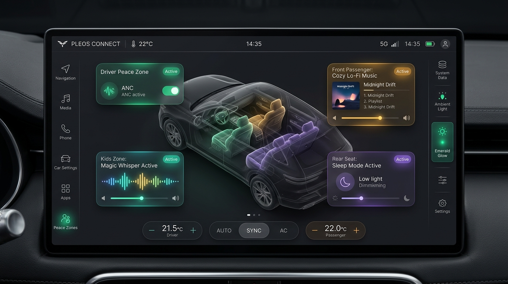
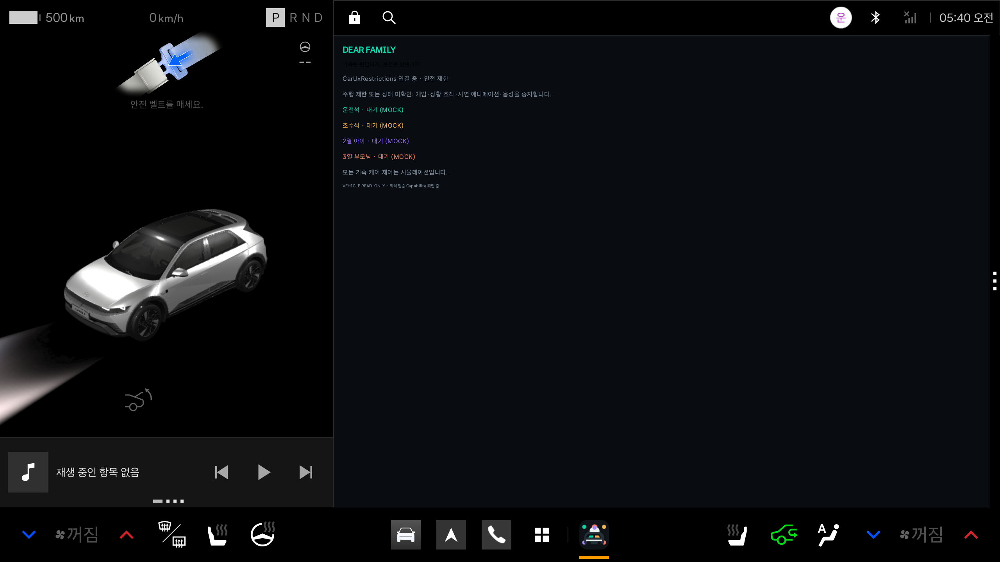
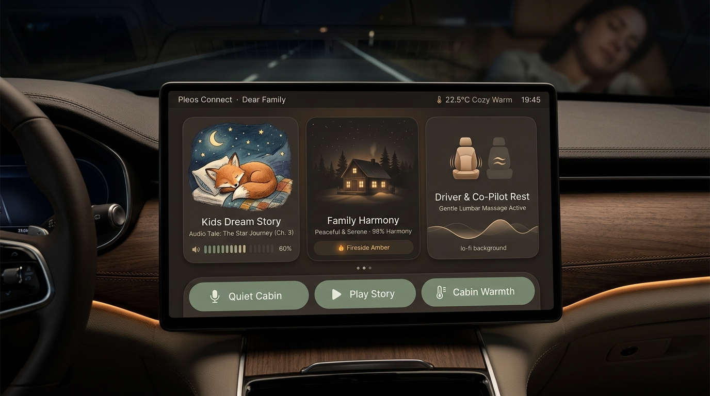
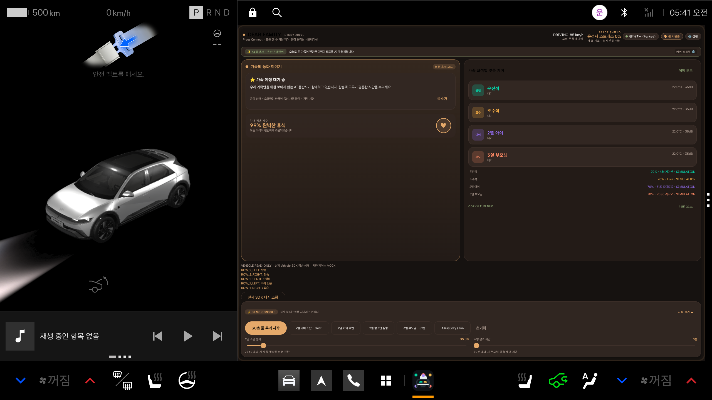
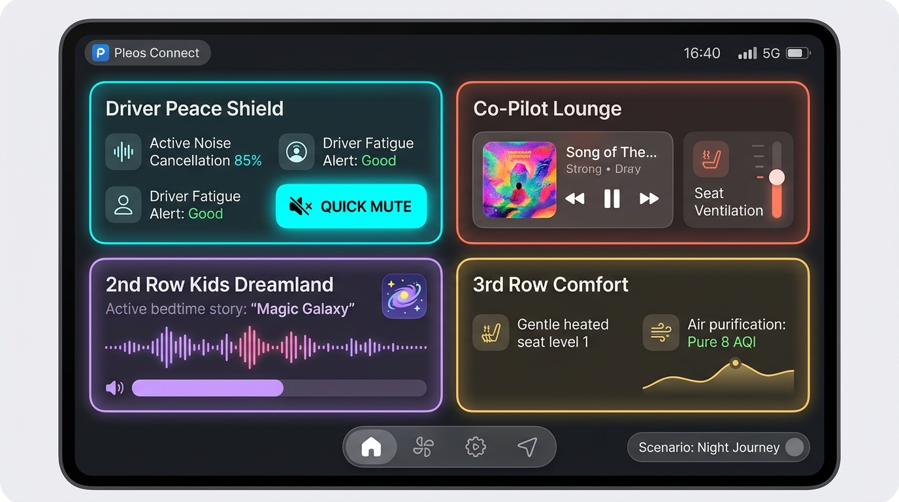
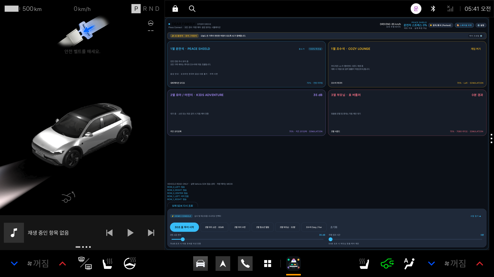
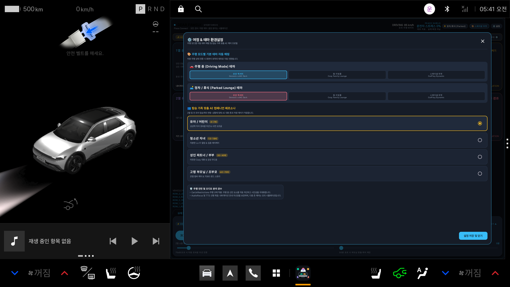

# Story Drive : Dear Family — UI/UX 디자인 시스템 및 시각화 명세서

> **목적:** 현대자동차 커넥티드 카 (Pleos Connect) 앱 개발 공모전 출품작의 디자인 일관성을 유지하고,  
> 3대 테마(Option 1, 2, 3) 및 다세대 가족 케어 시나리오의 시각적·기술적 명세를 제공합니다.

---

## 1. 3대 프리미엄 테마 시각화 카탈로그

디자인 기획 시안(AI Mockup)과 실제 공식 Pleos Connect 에뮬레이터(API 34, User 10)에서 렌더링된 화면의 비교 명세입니다.

### [Option 1] Genesis ccNC Modern Luxury Cockpit (플래그십 기본 테마)
* **비주얼 컨셉:** 딥 차콜 & 흑요석 블랙 글래스모피즘, 3D 와이어프레임 캐빈 디지털 트윈, 운전자 피스 실드(Peace Shield)
* **컴포넌트:** `GenesisLuxuryCockpitView.kt`
* **주요 타깃:** 현대/제네시스 순정 내비게이션 및 시스템 화면과의 완벽한 일체감 및 테크놀로지 프리미엄 경험

| 기획 시안 (Concept Mockup) | 실제 Pleos 에뮬레이터 구현 화면 (On-Device Screen) |
|:---:|:---:|
|  |  |

---

### [Option 2] Scandinavian Warm Family Lounge (정차/휴식 추천 테마)
* **비주얼 컨셉:** 웜 에스프레소, 무드 앰버, 세이지 그린 톤의 감성 거실, 밤하늘 동화책 일러스트 카드, 가족 화목 지수(Harmony Index) 원형 아크
* **컴포넌트:** `WarmFamilyStoryView.kt`
* **주요 타깃:** 가족의 감성적 힐링과 편안한 휴식, 아이들의 귓속말 동화 및 수면 유도

| 기획 시안 (Concept Mockup) | 실제 Pleos 에뮬레이터 구현 화면 (On-Device Screen) |
|:---:|:---:|
|  |  |

---

### [Option 3] Spatial Dynamic Cards (차세대 CarPlay / AAOS 위젯 스타일)
* **비주얼 컨셉:** 고대비 모던 카드 위젯, 볼드 타이포그래피, 직관적인 4대 독립 좌석 타일 제어
* **컴포넌트:** `SpatialDynamicCardsView.kt`
* **주요 타깃:** 높은 한눈 인지성(Glanceability) 및 큰 터치 타깃으로 주행 중 신속한 확인과 조작

| 기획 시안 (Concept Mockup) | 실제 Pleos 에뮬레이터 구현 화면 (On-Device Screen) |
|:---:|:---:|
|  |  |

---

### [설정 및 페르소나] 여정 & 테마 환경설정 다이얼로그
* **컴포넌트:** `DearFamilySettingsDialog.kt`
* **주요 기능:**
  * 주행 중(Driving Mode) 및 정차/휴식(Parked Lounge) 상태별 기본 테마 자동 매핑
  * 4대 가족 페르소나 (유아/어린이, 청소년 자녀, 성인 부부, 고령 부모님) 선택
  * CarUxRestrictions 주행 안전 및 AudioFocus 정책 확인

| 환경설정 다이얼로그 (Settings Dialog) |
|:---:|
|  |

---

## 2. 디자인 토큰 및 스타일 가이드 (`DearFamilyTheme.kt`)

### 컬러 팔레트 (Color Tokens)

```kotlin
// Option 1: Luxury Palette (Genesis ccNC Dark)
Background: Color(0xFF090D12)
CardBackground: Color(0xFF131A22)
CardBackgroundElevated: Color(0xFF1A232E)
CardBorder: Color(0xFF263342)
AccentPrimary (Emerald): Color(0xFF00E5B8)   // 운전석 & Peace Shield
AccentSecondary (Amber): Color(0xFFFFB347)  // 조수석 & Cozy Talk
AccentTertiary (Violet): Color(0xFF9B72FF)   // 2열 아이/청소년
AccentWarm (Coral): Color(0xFFFF8A65)        // 3열 부모님 온열

// Option 2: Warm Scandinavian Palette
Background: Color(0xFF191412)
CardBackground: Color(0xFF231C18)
CardBackgroundElevated: Color(0xFF2D2420)
CardBorder: Color(0xFF40342E)
AccentPrimary: Color(0xFFD4A373)             // 웜 우드골드
AccentSecondary: Color(0xFFE29578)           // 테라코타 피치
AccentTertiary: Color(0xFF83C5BE)            // 세이지 세레니티
AccentWarm: Color(0xFFE07A5F)                // 시에나 앰버

// Option 3: Spatial Dynamic Palette
Background: Color(0xFF0A0C10)
CardBackground: Color(0xFF141822)
CardBackgroundElevated: Color(0xFF1E2433)
CardBorder: Color(0xFF2E384D)
AccentPrimary: Color(0xFF38BDF8)             // 일렉트릭 시안
AccentSecondary: Color(0xFFFBBF24)           // 다이내믹 앰버
AccentTertiary: Color(0xFFA78BFA)            // 네온 바이올렛
AccentWarm: Color(0xFFFB7185)                // 코랄 로즈
```

### 타이포그래피 (Typography Hierarchy)
* **IVI Title Large:** `titleMedium` / `titleLarge`, `FontWeight.Bold`, 18~22sp (한눈 인지성 보장)
* **Body Medium:** `bodyMedium`, 14~15sp, LineHeight 20~22sp (가독성 높은 스토리 본문)
* **Label / Badge:** `labelSmall`, `FontWeight.Bold`, 10~12sp (상태 캡슐 및 태그)

---

## 3. 관련 상세 기획 문서 링크

* [UI 리디자인 컨셉 제안서 (ui-redesign-concepts.md)](ui-redesign-concepts.md): 초기 3대 시안 수립 배경 및 UI/UX 분석
* [무간섭 캐빈 하모니 시나리오 (cabin-harmony-scenarios.md)](cabin-harmony-scenarios.md): 4개 좌석 상호 무간섭 모달리티 (Ducking, Lumbar, Micro-climate, Ambient)
* [5단계 여정 풀 스토리 (full-journey-story-design.md)](full-journey-story-design.md): 시동부터 도착까지 이어지는 생애주기 케어 모델
* [프로젝트 아키텍처 및 상태 보고서 (project-status.md)](project-status.md): SDK 경계, Mock Adapter, 검증 매트릭스
