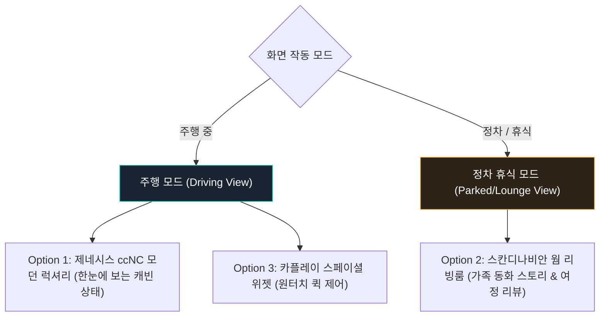

# 차량 내 다중 좌석 개별 케어: 하모니 오케스트레이션 기획

> [!NOTE]
> **핵심 질문:** "자동차는 벽으로 나뉜 독립 공간이 아닌데, 각 좌석의 개별 케어가 어떻게 서로 간섭하거나 시끄럽지 않게 공존할 수 있는가?"  
> **해결 철학:** 각 좌석이 소리를 크게 틀며 경쟁하는 '분리'가 아니라, **오디오 덕킹(Ducking), 무소음 촉각(시트 온열/요추), 마이크로 공조, 조명**을 조율하여 **전체 공간의 평온(Peace) 속에서 개별 배려가 연쇄되는 '하모니 오케스트레이션'**으로 해결합니다.

---

## 1. 개별 케어의 4대 비간섭 매개체 (Non-Interfering Modalities)

벽이 없는 차내에서 다른 사람을 방해하지 않는 개별 케어는 다음과 같은 물리적 특성을 활용합니다:

| 매개체 | 간섭 방지 원리 | 실제 케어 적용 예시 |
|---|---|---|
| **오디오 (Audio)** | **Ducking & Whisper** (소리를 덮지 않고 전체 볼륨을 낮춤) | 2열 아이 소란 시 시끄러운 만화를 틀어주는 대신, **가장 작은 귓속말(Magic Whisper)**을 유도해 차내 전체를 조용하게 만듦. 수면 시 즉시 완전 음소거. |
| **촉각 (Tactile)** | **무음 시트 온열 & 햅틱** (100% 무소음 개별 전달) | 자는 아이를 깨우지 않고 3열 부모님 피로를 케어할 때 음성 안내를 쓰지 않고, **등받이 온열 1단 + 요추 마사지(Lumbar)** 작동. |
| **공조 (Climate)** | **마이크로 직풍/간접풍 제어** | 잠든 2열 아이 쪽은 창문 블라인드 잠금 및 직풍을 부드러운 간접 미풍(Breeze 22.5°C)으로 전환. |
| **시각 (Visual)** | **독립 앰비언트 & 독서등** | 2열 수면 시 2열 상단 독서등 자동 OFF, 차내 전체는 눈부심 없는 심야 웜 앰비언트로 차분하게 가라앉힘. |

---

## 2. 3대 Main Scene + Sub Scene 연쇄 시나리오

```mermaid
sequenceDiagram
    autonumber
    actor Driver as 1열 운전석
    actor Passenger as 1열 조수석
    actor Kids as 2열 아이들
    actor Parents as 3열 부모님
    
    rect rgb(20, 30, 45)
    note over Driver,Parents: [Scene 1: 터널 진입 & 매직 위스퍼] 소란을 소리로 덮지 않고 정숙으로 전환
    Kids->>Kids: 82dB 소란 발생 (지루함)
    Note over Driver,Parents: NaviHelper: 300m 앞 터널 진입 감지 -> 보라색 앰비언트 전환
    Kids->>Kids: Magic Whisper: "쉿! 잠든 거인의 비밀 터널이야. 구름사탕이라고 속삭여볼까?"
    Kids->>Kids: 아이들이 숨을 죽이고 귓속말 게임에 집중 (소음 82dB -> 35dB 급감)
    Driver->>Driver: Peace Shield: 전방 시야 확보 및 내비 무간섭 유지
    end

    rect rgb(30, 40, 30)
    note over Driver,Parents: [Scene 2: 슬립 랜딩 & 사일런트 효 버틀러] 자는 아이를 깨우지 않는 연쇄 케어
    Kids->>Kids: 3분간 정숙, 눈 감김 -> 수면 감지 (Sleep Landing)
    Kids->>Kids: 2열 즉시 오디오 MUTE, 독서등 OFF, 22.5°C 간접풍
    Parents->>Parents: 50분 경과 부모님 피로 감지 -> 음성 없이 시트 온열 1단 + 요추 마사지 작동!
    Passenger->>Passenger: Lo-Fi 음악 70% -> 25% 자연 페이드아웃 (부부의 조용한 대화 라운지)
    end

    rect rgb(45, 30, 20)
    note over Driver,Parents: [Scene 3: 조수석 스마트 협업 & 부드러운 의사결정] 운전자 주의 분산 0
    Parents->>Parents: 장거리 피로 지속 (휴게소 필요)
    Driver->>Driver: 운전자에게 질문 팝업 금지 (전방 주시 유지)
    Passenger->>Passenger: 조수석 화면에만 나직한 추천 카드: "5km 앞 횡성휴게소, 호두과자 경유할까요?"
    Passenger->>Passenger: 조수석에서 [경유 승인] 터치
    Driver->>Driver: 내비게이션 경로에 무음으로 경유지 추가 반영
    Parents->>Parents: 부모님 앞 디스플레이에 "곧 휴게소에 도착합니다" 부드러운 안내
    end
```

---

### [Scene 1] 터널 진입 & 매직 위스퍼 (Magic Whisper in the Tunnel)
- **상황:** 고속도로 주행 40분째, 2열 아이들이 지루해져서 큰 소리로 장난치며 82dB의 소란이 발생.
- **물리적 충돌 딜레마:** 2열에 만화나 음악을 크게 틀어주면 운전자가 시끄럽고 부모님도 피곤해짐.
- **오케스트레이션 해결책:**
  - **Main Scene:** 전방 300m 앞 터널 진입 정보를 받아 차내 앰비언트 라이트가 신비로운 보랏빛으로 은은하게 디밍.
  - **Sub Scene (2열):** 소리를 지르는 대신, 2열 스피커에서 나직하고 매력적인 동화 내레이션이 시작됨:  
    *"쉿! 다들 내 목소리 들리니? 지금 우리 차가 잠든 거인이 사는 비밀 터널에 들어왔어. 거인이 깨지 않게 가장 작은 귓속말로 구름 사탕이라고 속삭여 볼까?"*
  - **Sub Scene (1열/3열):** 아이들이 거인을 깨우지 않기 위해 일제히 입을 다물고 속삭이기 시작함. 실내 소음이 82dB에서 35dB로 뚝 떨어지며, 운전석에는 '평온 유지(Peace Shield)' 알림만 조용히 점등.

---

### [Scene 2] 슬립 랜딩 & 사일런트 효 버틀러 (Silent Sleep Landing & Caring)
- **상황:** 귓속말 놀이를 하던 아이들이 스르륵 잠에 빠져듦. 한편 3열의 할머니/할아버지는 1시간 가까운 탑승으로 허리가 뻐근하여 자세를 뒤척임.
- **물리적 충돌 딜레마:** 부모님께 "어르신, 허리 마사지를 켜드릴까요?" 하고 스피커로 안내 방송을 하면 갓 잠든 2열 아이들이 깨버림.
- **오케스트레이션 해결책:**
  - **Sub Scene (2열 아이 - Sleep Landing):** 아이 수면 감지 즉시 2열 오디오 완전 MUTE, 2열 천장 독서등 OFF, 에어컨 직풍 모드를 간접 미풍(22.5°C)으로 전환.
  - **Sub Scene (3열 부모님 - 무음 케어):** 아이가 깨지 않도록 음성 TTS를 **100% 차단**. 대신 **3열 시트 등받이 온열 1단과 요추 받침(Lumbar) 마사지를 부드럽게 무소음 가동**.
  - **Sub Scene (1열 조수석 - Cozy Lounge):** 조수석의 Lo-Fi 음악이 70%에서 25%로 자연스럽게 덕킹(Ducking)되어, 자는 아이와 쉬시는 부모님을 방해하지 않고 부부가 나직하게 심야 드라이브 대화를 나눌 수 있는 분위기 조성.

---

### [Scene 3] 조수석 코파일럿 협업 & 무음 경유 (Co-Pilot Decision)
- **상황:** 부모님의 피로 누적으로 휴식이 필요한 타이밍.
- **물리적 충돌 딜레마:** 운전자에게 질문을 던지거나 중앙 화면에 큰 팝업을 띄우면 고속도로 주행 안전에 방해가 됨.
- **오케스트레이션 해결책:**
  - **Main Scene (운전자 보호):** 운전석 HUD 및 클러스터는 전방 내비게이션 안내만 지속 (Driver Distraction 방지).
  - **Sub Scene (조수석 협업):** 조수석 방향 디스플레이에만 부드러운 카드 노출: *"부모님 탑승 55분 경과. 5km 앞 횡성휴게소에서 호두과자와 15분 휴식을 추천합니다."*
  - **인터랙션:** 조수석 탑승자가 터치로 [경유지 추가]를 승인하면, 운전자에게 말로 묻지 않고 내비게이션 경로에 조용히 휴게소가 추가됨.

---

## 3. UI 테마 및 상황 연동 전략

사용자께서 제안해 주신 **"상황별 테마 전환 + 사용자 수동 테마 선택"**이 완벽한 정답입니다!

1. **주행 중 (Driving Mode):**
   - 불필요한 장식 텍스트를 제거하고, **Option 1(ccNC 럭셔리 다크)** 또는 **Option 3(볼드 위젯)**으로 운전자 주의 분산을 막는 직관적 화면 제공.
2. **정차 중 (Parked / Rest Stop Mode):**
   - 시동이 꺼지거나 P단 정차 시, 화면이 **Option 2(웜 리빙룸 감성)**로 자연스럽게 전환되어 가족들이 다 함께 따뜻한 동화 일러스트와 여행 하모니 리포트를 감상.
3. **수동 테마 픽커:**
   - 상단 헤더의 테마 버튼으로 언제든 원하는 디자인(다크 럭셔리 / 웜 코지 / 스페이셜 위젯)으로 직접 전환 가능.
