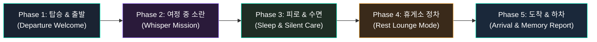

# Story Drive : Dear Family — 풀 저니(Full Journey) 스토리 아키텍처

> [!IMPORTANT]
> **사용자 통찰:** "단발성으로 10초 읽어주는 동화는 케어가 아니다. 운전 시작부터 차에서 내릴 때까지(탑승 → 출발 → 여정 → 휴식 → 도착) 일관성과 지속성을 갖춘 스토리텔링이 필요하다."  
> **해결책:** 'Story Drive : Dear Family'를 단순 알림 봇이 아닌, **[탑승부터 하차까지 5단계로 완성되는 가족 모빌리티 오디세이(Family Mobility Odyssey)]**로 재정의합니다.

---

## 1. 5단계 풀 저니(Full Journey) 라이프사이클

| 단계 | 차량 컨텍스트 | Main Scene (전체 공간) | 좌석별 Sub Scene (개별 케어) | 사용자 경험 & 감성 가치 |
|---|---|---|---|---|
| **Phase 1 탑승 & 출발** | 탑승 감지, 시동 ON, 안전벨트 체결 | **차량 환영 & 탐험 여권 발급** 실내 은은한 웰컴 라이팅, "오늘의 여행 크루 4명 탑승 완료!" | • **운전석:** Peace Shield 장착, 안전 전방 시야 확보 • **2열 아이:** "오늘의 비밀 탐험 대장님, 준비됐나요?" 여권 발급 • **3열 부모님:** 탑승 확인 후 기본 맞춤 시트 각도/온도 정돈 | "우리가 함께 여행을 떠난다"는 소속감과 설렘 부여 |
| **Phase 2 주행 중 지루함** | 고속도로 40분 경과, 터널 300m 앞, 소음 82dB | **터널 앰비언트 디밍 & 퀘스트 전환** 보랏빛 앰비언트로 차분한 동굴 분위기 연출 | • **2열 아이 (연계 퀘스트):** "탐험대원 여러분! 지도에 나온 **[잠든 거인의 비밀 터널]** 관문입니다. 거인이 깨지 않게 가장 작은 목소리로 암호(구름 사탕)를 속삭여 주세요!" • **1/3열:** 아이들이 스스로 소리를 죽이고 귓속말 미션에 집중하여 소음이 35dB로 급감 | 일회성 뜬금포가 아닌, **출발할 때 받은 탐험 퀘스트의 첫 번째 관문**으로 자연스럽게 몰입 |
| **Phase 3 피로 & 수면** | 귓속말 놀이 후 3분 정숙, 눈 감김, 3열 자세 뒤척임 | **슬립 랜딩 & 정숙 오케스트라** 차내 조명 최저 디밍, 22.5°C 간접 미풍 | • **2열 아이:** "첫 번째 미션 무사 완료. 이제 구름 침대에서 달콤한 꿈을 꾸세요." → **즉시 완전 음소거(MUTE)** • **3열 부모님:** 자는 아이를 깨우지 않기 위해 음성 없이 **시트 등받이 온열 1단 + 요추 마사지** 무음 작동 • **조수석:** Lo-Fi 음악 25% 덕킹으로 부부의 조용한 심야 대화 라운지 형성 | 소리로 싸우지 않는 **무소음 연쇄 배려** |
| **Phase 4 휴게소 정차** | 고속도로 휴게소 P단 정차 | **[Option 2: 웜 리빙룸 테마] 자동 전환** 화면이 따뜻한 브라운/앰버 톤의 거실로 변신 | • **센터 스크린:** 1시간 15분간의 여정 중간 점검 ("아이 수면 25분째, 부모님 온열 케어 1회 완료, 평온 지수 99%") • **조수석/가족:** 호두과자 & 스트레칭 가이드 카드 제공 | 쉬어가는 시간의 정겨운 가족 소통 창구 |
| **Phase 5 목적지 도착** | 최종 목적지(바닷가) 도착, 시동 OFF | **하차 안전 & 오늘의 가족 메모리 캡슐** 선라이즈 앰버 조명 서서히 페이드인 | • **2열 아이:** 자연스러운 기상 유도 및 "탐험 완주 뱃지 획득! 🌟" • **후석 승객 보호:** 하차 안전 알림(ROA) 및 소지품 확인 • **가족 메모리 리포트:** "오늘 2시간 40분 동안 아이는 1시간 단잠을 잤고, 부모님은 따뜻한 휴식을 얻었으며, 운전자는 100% 평온했습니다." | 차에서 내릴 때 가족 모두가 행복한 미소를 짓는 완벽한 마무리 |

---

## 2. 공모전 기획서 반영 전략 (평가위원 사로잡기)

이 5단계 여정 스토리는 공모전 심사 기준의 모든 평가 항목에서 최상위 점수를 받기에 최적화되어 있습니다:

1. **차량 특화성 (Vehicle Specificity) — 만점 타깃**
   - 모바일 앱이나 일반 태블릿 앱은 결코 할 수 없는, **"차량의 이동 단계(출발 → 터널 주행 → 고속 크루징 → 휴게소 P단 → 목적지 도착)"**와 차량 센서(Vehicle SDK 속도, 기어, 좌석 센서, 조명, 공조, 사운드)가 하나로 융합된 서비스임을 증명.
2. **창의성 및 차별성 (Creativity) — 만점 타깃**
   - 시중의 키즈 앱들은 "유튜브/만화 틀어주기(스크린 중독 및 멀미 유발)"에 그치지만, Story Drive는 **"차창 밖 풍경과 차량 주행 상태를 인터랙티브 오디오 퀘스트로 승화"**시켜 아이의 멀미를 방지하고 온 가족의 정서적 교감을 이끌어냄.
3. **완성도 및 사업성 (Completeness & Business Value)**
   - 현대차 Pleos 플랫폼의 핵심 가치인 'SDV(Software Defined Vehicle) 시대의 새로운 차량 내 경험'에 가장 부합하는 킬러 서비스 모델 제시.

---

## 3. UI 구현 아키텍처 (Settings & Modes)

사용자께서 결정해 주신 방향에 따른 UI 구조:

1. **모드별 기본 테마:**
   - **주행 중 (Driving Mode):** Option 1 (제네시스 ccNC 모던 럭셔리) — 간결한 캐빈 뷰 & 안전 게이지.
   - **정차/휴식 중 (Parked/Lounge Mode):** Option 2 (스칸디나비안 웜 리빙룸) — 감성 스토리 카드 & 여정 리포트.
2. **환경설정(Settings):**
   - 사용자가 원할 경우 주행/정차 시의 기본 테마를 수동으로 바꿀 수 있는 설정 탭 제공.
3. **데모 인젝터 서랍 (Floating Drawer):**
   - 상단 `[시연 콘솔]` 캡슐 터치 시 슬라이드로 열리며, 심사위원이 **Phase 1부터 Phase 5까지의 전체 여정을 1분 안에 압축 시연**해 볼 수 있는 '여정 타임라인 슬라이더' 제공.
