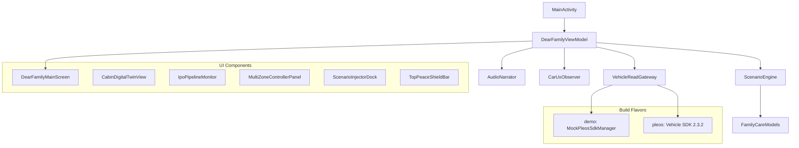

# Story Drive : Dear Family — 프로젝트 현황 인계 보고서

> [!IMPORTANT]
> **마감: 2026-11-15 23:59 KST (D-6)**
> 현재 **28/40 태스크 완료 (70%)**, 필수 접수 요건 **4/8 (50%)**

---

## 프로젝트 개요

**현대 차량용 앱 개발 공모전** 출품작. Kotlin / Jetpack Compose 기반의 가족 케어 차량용 앱.

| 항목 | 내용 |
|---|---|
| 앱 이름 | Story Drive : Dear Family |
| 플랫폼 | Pleos Connect (현대 차량 플랫폼) |
| 핵심 기능 | 4좌석 가족 케어 (아이 소란·수면, 부모님 피로, 조수석 대화) |
| 빌드 환경 | JDK 17, Kotlin 1.9.25, Compose Compiler 1.5.15, AGP 8.2.2, SDK 34 |
| Vehicle SDK | `ai.pleos.playground:Vehicle:2.3.2` (pleos flavor 전용) |

## 아키텍처

**두 실행 경로:**
- **`demo`** — 외부 서버·API Key 없는 오프라인 가족 케어 시연. Mock 전용.
- **`pleos`** — Vehicle SDK 좌석 탑승 상태 읽기/구독. 공조·온열·음장 출력은 여전히 MOCK.

## 마일스톤 진행 현황

| 마일스톤 | 범위 | 진척률 | 상태 |
|---|---|---:|---|
| M1 | 요구사항·공식 정책·접수 요건 | **100%** | ✅ 완료 |
| M2 | 5대 시나리오 엔진 구현 | **100%** | ✅ 완료 |
| M3 | 화면·오프라인 오디오 구현 | **100%** | ✅ 완료 |
| M4 | 네이티브 빌드·공식 Pleos 구동 | **100%** | ✅ 완료 |
| M5 | Pleos 통합·실행 기능 검증 | **80%** | 🔄 1건 진행중 |
| M6 | 안전성·성능·호환 QA | **0%** | ⬜ 미착수~진행중 |
| M7 | 필수 기획서·개인정보 동의서 | **60%** | 🔒 사용자 승인 대기 |
| M8 | 가산점 패키지·최종 접수 | **20%** | 🔒 사용자 승인 대기 |

## 남은 12개 태스크 상세

### 🔴 사용자 직접 조치 필요 (3건 — 접수의 핵심)

| ID | 태스크 | 상태 |
|---|---|---|
| **M7.4** | 개인 참가 정보·본인 동의/서명/날짜 확정 | 🔒 사용자 작성 필요 |
| **M8.3** | GitHub 업로드·심사자 접근 확인 | 🔒 사용자 승인 필요 |
| **M8.4** | 최종 사용자 승인·접수 메일 송부 | 🔒 사용자 승인 필요 |

### 🟡 Mac 재개 후 기기 검증 필요 (5건)

| ID | 태스크 | 상태 |
|---|---|---|
| **M5.1** | Virtual Console ↔ 좌석 SDK 왕복 검증 | 진행중 |
| **M6.1** | 정차/주행/미확인 Car UX 제한 검증 | 미착수 |
| **M6.2** | AudioFocus 거절·손실·duck 실기 검증 | 미착수 |
| **M6.3** | 백그라운드·재생성·Suspend/Resume 검증 | 일부 진행 |
| **M6.4** | 가로·세로·좁은 창·접근성 검증 | 미착수 |

### 🟢 현재 환경(Mac)에서 진행 가능 (4건)

| ID | 태스크 | 선행 조건 |
|---|---|---|
| **M6.5** | 최종 품질 게이트·성능·lint 정리 | lint 통과 완료, CPU/RAM 측정 남음 |
| **M7.5** | 필수 서류·형식·제목·CC 검수 | M7.4 완료 후 |
| **M8.1** | release APK·최종 소스 패키지 준비 | 서명키 확보 필요 |
| **M8.5** | 접수 결과 확인·제출본 동결 | M8.4 완료 후 |

## 알려진 기술적 이슈

1. **TTS 초기화 실패** — 공식 에뮬레이터 foreground user 10에서 `init=-1, engine=null`. 자막 대체 중. 음성 성공이 아님.
2. **Virtual Console DDS 미연결** — `bridge_ready=false`, `actual gear=null`. SDK 좌석 왕복 미검증.
3. **Release APK 미서명** — debug APK만 존재. 서명키·설치 검증 필요.
4. **Manifest icon 미연결** — adaptive icon XML은 생성했으나 `<application>` 태그에 아직 미연결.

## 제출 요건 요약

| 구분 | 항목 | 상태 |
|---|---|---|
| **필수** | 작성한 접수양식(기획서) | ✅ 초안 완성, 서명·개인정보 미기입 |
| **필수** | 개인정보 동의·서명·날짜 | ❌ 사용자 직접 작성 필요 |
| 선택 가산 | 시연 영상 | ✅ 28.5초 무음·자막 편집본 완성 |
| 선택 가산 | GitHub + release APK | 🔄 소스 push됨, release APK 미서명 |

> [!NOTE]
> **수신: appdevchallenge@hyundai-partners.com**
> 제목 형식: `[차량용 앱 개발 공모전] 성명_성명` (개인 참가)
> 영상/GitHub/APK가 준비 안 됐더라도 필수 서류만으로 접수 가능

## 즉시 진행 가능한 작업

이 Mac 환경에서 지금 할 수 있는 것:

1. **Manifest icon 연결** — `android:icon`/`android:roundIcon` 추가
2. **lint 재실행** — 4 variant lint 확인
3. **빌드 검증** — `assembleDemoDebug`/`assemblePleosDebug` 재빌드
4. **release signing 설정** — 사용자 서명키 확보 시
5. **소스 패키지 재생성** — `python3 scripts/package_source.py`
6. **TTS/Console 진단** — 에뮬레이터 재개 시 `mac-resume-checklist.md` 순서대로

## 핵심 문서 참조

- [AGENTS.md](file:///Users/nathanael/git/story-drive-dear-family/AGENTS.md) — 개발 작업 지침 (모든 작업의 기본 규칙)
- [pleos-development-guidelines.md](file:///Users/nathanael/git/story-drive-dear-family/docs/pleos-development-guidelines.md) — Pleos 공식 개발 가이드 준수 지침
- [SESSION_HANDOFF.md](file:///Users/nathanael/git/story-drive-dear-family/docs/SESSION_HANDOFF.md) — 작업 인계 문서
- [OWNER_DECISIONS.md](file:///Users/nathanael/git/story-drive-dear-family/docs/OWNER_DECISIONS.md) — 사용자 확인 필요 항목
- [SUBMISSION_MILESTONES.md](file:///Users/nathanael/git/story-drive-dear-family/docs/SUBMISSION_MILESTONES.md) — 전체 40개 태스크 목록
- [mac-resume-checklist.md](file:///Users/nathanael/git/story-drive-dear-family/docs/mac-resume-checklist.md) — Mac 재개 후 진단 순서
