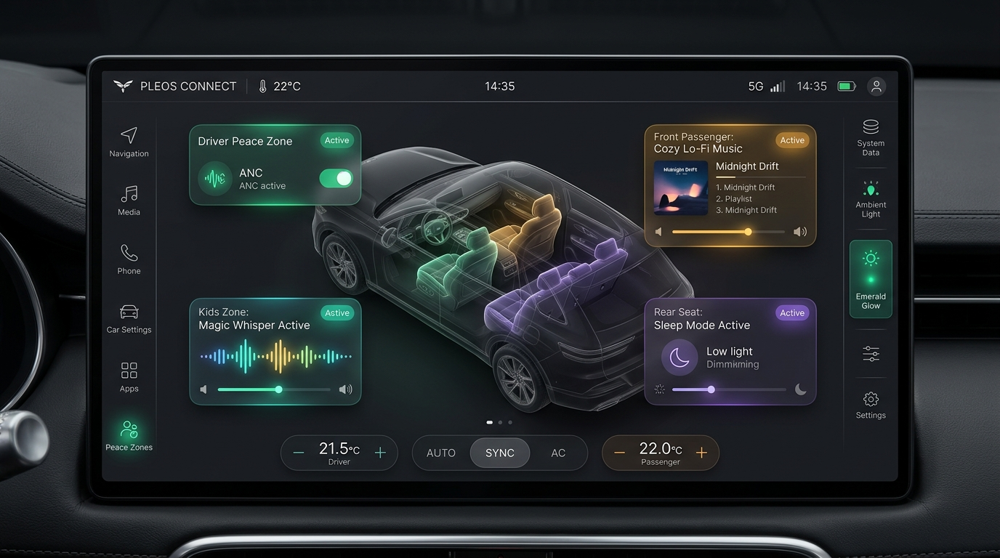
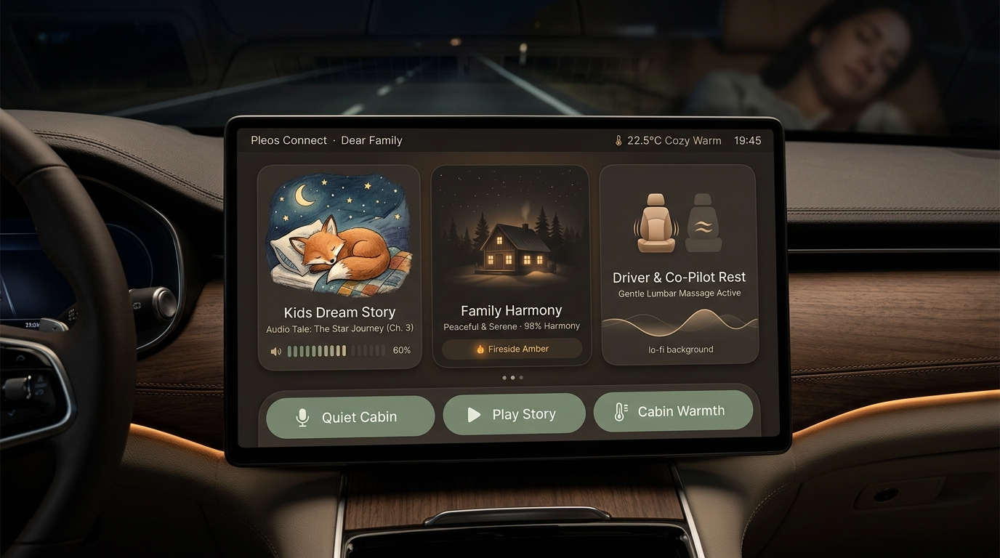
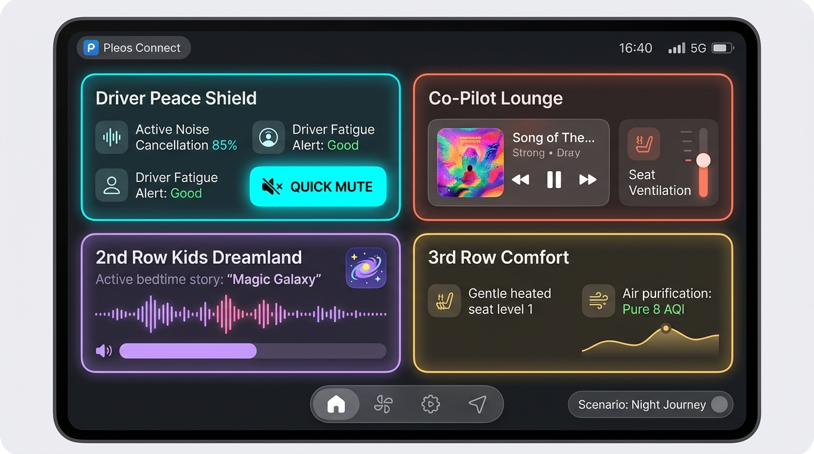
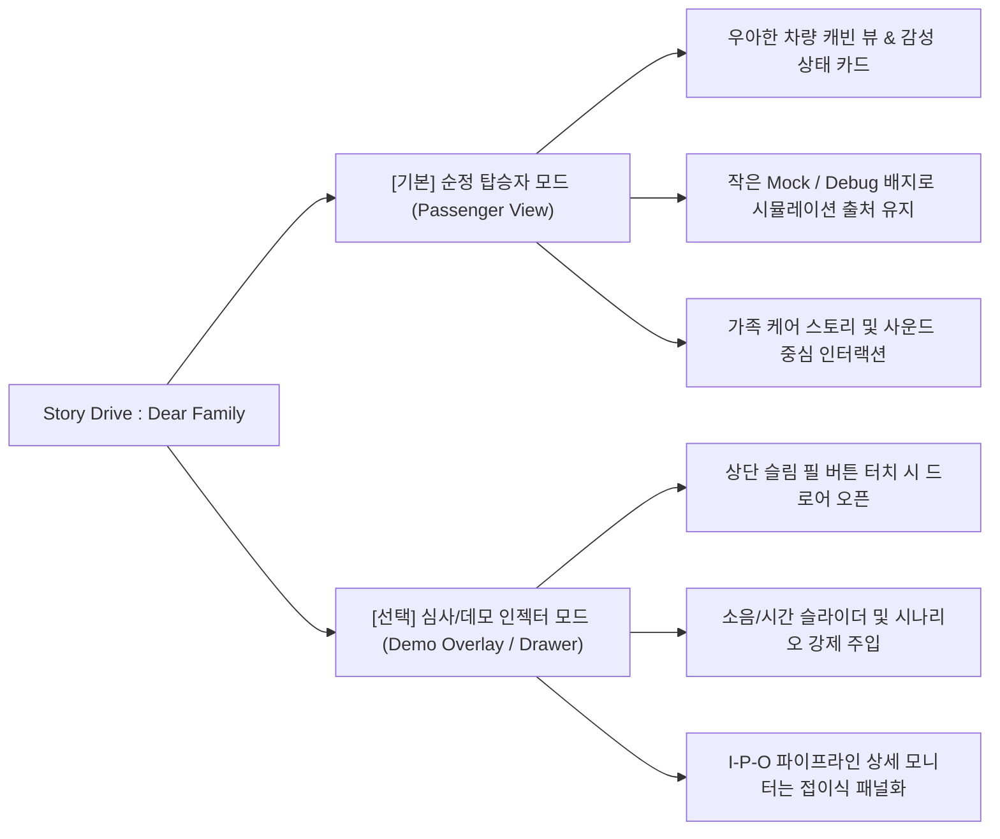

# Story Drive : Dear Family — UI/UX 리디자인 컨셉 제안서

> **시각적 Single Source of Truth:** `images/ui_mockup_option{1,2,3}_*.jpg` 원본 시안 이미지다. 텍스트 설명과 충돌하면 이미지를 우선한다. 최신 사용자 작업 지시서의 명시적 변경(카드 내부 CTA 등)과 Pleos 안전·창 정책은 예외로 기록한다. 기능은 Mock 제어와 실제 SDK 읽기를 구분한다.

> [!IMPORTANT]
> **사용자 피드백 반영:** "기존 UI는 엔지니어링 디버그 콘솔 같고, AI로 대충 만든 것처럼 투박하다."  
> 현대차 Pleos Connect 환경에 걸맞은 **실제 양산형 프리미엄 인포테인먼트(IVI)** 수준으로 전면 쇄신하기 위해 **3가지 완전히 차별화된 디자인 시안**을 제작했습니다.

---

## 1. 기존 UI가 "투박한 AI 프로토타입" 같았던 이유 분석

1. **엔지니어링 모니터링 화면 구성**
   - `01 CABIN DIGITAL TWIN`, `02 LIVE INPUT → PROCESSING → OUTPUT`, `03 MULTI-ZONE AUDIO ROUTING` 등 컴퓨터 공학적 파이프라인 명칭과 번호가 화면의 절반을 차지.
   - `● cabin_mic 82dB Vehicle SDK · MOCK` 같은 센서 원시 데이터가 마치 Grafana 대시보드처럼 나열되어 탑승자 경험보다 개발자 디버그 툴에 가까웠음.

2. **차량용 UI(IVI) 원칙인 '글랜서빌리티(한눈 인지성)' 결여**
   - 10~13sp 수준의 작은 글씨와 긴 설명글이 빽빽하게 박스 안에 갇혀 있어, 1~2초 내에 직관적으로 파악해야 하는 차량 디스플레이 기준에 부적합.

3. **'가족 감성(Family Story)'의 실종**
   - 아이의 소란 완화나 수면 유도, 부모님 휴식 등 따뜻한 가족 이야기가 중심인 앱인데, 딱딱한 회색 박스(`0xFF1A2028`)와 네온 라인만 강조되어 감성적 온기가 전혀 느껴지지 않음.

4. **데모 인젝터와 실사용 모드의 미분리**
   - 심사/시연용 버튼("아이 소란 82dB", 슬라이더)이 메인 화면 하단에 상시 노출되어 실제 차량 앱으로서의 완성도를 떨어뜨림.

---

## 2. 3가지 디자인 시안

### [Option 1] Modern Automotive Luxury (제네시스 ccNC / 폴스타 스타일)

* **비주얼 컨셉:** 딥 차콜 & 흑요석 블랙 글래스모피즘, 절제된 네온 앰비언트 글로우(에메랄드, 골드 앰버, 바이올렛).
* **레이아웃:**
  * **중앙:** 원본의 사선 방향 3D 차량 컷어웨이 비트맵과 좌석 발광 오버레이. 평면 대칭 차량 선화로 대체하지 않는다.
  * **좌/우:** 운전자 피스 실드 게이지 및 좌석별 마이크로 위젯(아이 존: 매직 위스퍼 활성, 3열: 온열/요추 받침).
  * **하단:** 현대차 순정 IVI 느낌의 정제된 슬림 플로팅 컨트롤 바.
* **장점:** 현대/제네시스 순정 내비게이션 및 시스템 화면과 가장 일체감이 높고 프로페셔널한 완성도를 줌.
* **적합 대상:** 기술적 완성도와 세련된 프리미엄 자동차 HMI를 선호할 때.

---

### [Option 2] Warm Emotional Family Care (스칸디나비안 웜 리빙룸 감성 스타일)

* **비주얼 컨셉:** 웜 에스프레소, 무드 앰버, 세이지 그린 톤의 따뜻하고 편안한 이동형 거실.
* **레이아웃:**
  * **좌측:** 현재 진행 중인 가족 스토리 카드 (예: 밤하늘 동화책 일러스트와 함께 "잠든 거인의 비밀 터널 이야기 재생 중").
  * **중앙:** 야간 오두막 일러스트 중심의 Family Harmony 카드. 화목 지수와 실내 분위기를 함께 표시한다.
  * **우측:** 직관적인 좌석별 퀵 릴랙스 타일(아이 꿀잠 모드, 부모님 온열 마사지 모드).
* **장점:** 'Story Drive : Dear Family'라는 브랜드 아이덴티티와 가장 잘 맞으며, 심사위원에게 감성적 차별화로 큰 호평을 받을 수 있음.
* **적합 대상:** 딱딱한 기계 느낌을 벗어나 가족의 힐링과 편안함을 시각적으로 증명하고 싶을 때.

---

### [Option 3] Spatial Dynamic Cards (차세대 카플레이 & 안드로이드 오토 위젯 스타일)

* **비주얼 컨셉:** 고대비 모던 카드 위젯, 볼드한 타이포그래피, 다이내믹 웨이브폼 오디오 비주얼라이저.
* **레이아웃:**
  * 4개 독립 좌석 카드(운전석 Peace Shield, 조수석 Cozy Lounge, 2열 Kids Dreamland, 3열 Grandparents Care)가 화면을 4분할하여 큼직하게 배치.
  * 각 카드 터치 시 즉시 해당 좌석의 사운드 덕킹, 조명, 온도를 손쉽게 제어.
  * 데모/개발자용 센서 인젝터는 상단 미니 캡슐 필(Pill)로 최소화.
* **장점:** 조작성이 가장 뛰어나며, 터치 타깃이 크고 명확하여 주행/정차 시 직관성이 가장 높음.
* **적합 대상:** 현대적인 앱 인터페이스 느낌과 즉각적인 좌석별 인터랙션을 강조하고 싶을 때.

---

## 3. UI/UX 구조적 개편 전략: "2중 모드 시스템"

* **일반 모드:** 순정 완성차 앱처럼 군더더기 없는 고급 화면 (세련된 상태 메시지와 실시간 인터랙션 중심).
* **시연/심사 모드:** 심사위원이 직접 센서를 조작해 볼 수 있도록 접이식 슬림 드로어(`[⚡ DEMO CONSOLE]`)를 제공하여 30초 풀 투어 및 센서 시뮬레이션 지원.
